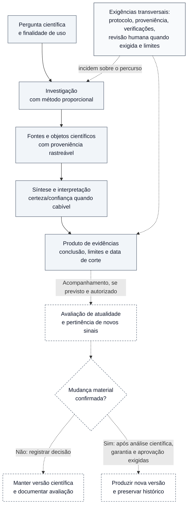

# Figura 1 — Visão geral do OES: esquema conceitual editável

**Estado:** PROTÓTIPO EDITORIAL NÃO APROVADO. Não integrado ao manuscrito; não constitui validação científica nem comprovação de execução operacional.
**Manuscrito-base:** [Fundamentos científicos, arquitetura metodológica e modelo de desenvolvimento](../oes-fundamentos-arquitetura-modelo-desenvolvimento.md), versão 0.46, sobretudo §1.4, §4.1 e §6.1.
**Plano:** [Plano editorial visual](../oes-plano-editorial-visual-manuscrito.md), Figura 1.
**Inserção proposta:** §1.4, depois da apresentação do encadeamento conceitual.
**Natureza:** desenho conceitual das funções propostas, não registro de capacidades plenamente operantes.

## Esquema editável — revisão semântica para leitura em A4

Orientação **vertical**, com o processo científico principal em traço contínuo e a manutenção eventual em **traço pontilhado**. A bifurcação na avaliação de materialidade evita apresentar cada sinal como causa necessária de uma atualização.

**Leitura correta:** o encadeamento contínuo é uma representação conceitual do percurso geral. A manutenção é condicional e não presume execução factual; as saídas da decisão de materialidade são ilustrativas, não substituem a máquina canônica de estados de atualidade ou os protocolos de aprovação. Na hipótese de mudança material, **não há atualização automática**: nova versão só pode ser produzida após análise, garantia e decisões cabíveis. A ausência de mudança material também exige registro justificado, não equivale a afirmar que a busca foi completa. As ligações à caixa transversal **não são a sequência dos gates**, mas sinalizam exigências que incidem em pontos distintos do processo.

**Nota de revisão gráfica:** a orientação vertical reduz o risco de um diagrama excessivamente horizontal. Entretanto, o diagrama Mermaid precisa ser **renderizado e inspecionado** antes de atestar legibilidade em tamanho A4, contraste e ausência de cruzamentos de arestas; a fonte textual isolada não permite certificar esses requisitos.

## Legenda proposta para o manuscrito

**Figura 1 — Organização conceitual proposta para o Observatório de Evidências em Saúde (OES).** A pergunta orienta uma investigação metodologicamente proporcional; fontes, estudos, relatórios, resultados e demais objetos científicos sustentam a interpretação e o produto comunicável. Acompanhamento, reavaliação e novas versões são condicionais e dependem de critérios e autorizações. **Os blocos não representam serviços necessariamente operacionais:** a Fase 4 permanece em desenvolvimento, M3 está bloqueado, e a validação científica independente do modelo não foi realizada na data de referência (20 de outubro de 2026). Fonte: elaboração editorial baseada nos Documentos 02, 04 e 40 do OES, em `STATE.md` e no checkpoint CP213.

## Texto alternativo proposto (acessibilidade)

“Fluxo conceitual de cima para baixo: pergunta científica; investigação proporcional; fontes e objetos rastreáveis; síntese e interpretação, com certeza/confiança quando cabível; produto de evidências. Em ramo pontilhado condicional, avaliação de atualidade e de sinais leva à decisão sobre mudança material. Sem mudança confirmada, conserva-se a versão e registra-se a avaliação; com mudança confirmada, uma nova versão depende de análise científica, garantia e aprovação pertinentes. Uma caixa de controles transversais liga-se à investigação e ao produto, sem indicar operação contínua efetiva.”

## Verificações antes de inserir no manuscrito

- [ ] Inspecionar visualmente o diagrama renderizado (quebras de linha, leitura em A4 e em preto e branco).
- [ ] Conferir a terminologia com os documentos canônicos de investigação, produtos, governança e atualização.
- [ ] Garantir que a condição de revisão independente para A3 não foi implicitamente satisfeita na figura.
- [ ] Conferir que monitoramento factual persistente e M3 não são apresentados como recursos já liberados.
- [ ] Ajustar a legenda e a referência cruzada no texto do Capítulo 1 apenas após aprovação editorial.
- [ ] Se houver exportação em SVG/PDF, verificar a legibilidade e o texto alternativo.

**Resultado desta revisão:** a semântica do percurso, os caminhos condicionais e as ressalvas científicas foram conferidos e corrigidos no esquema editável. **Pendente:** inspeção de uma renderização real em A4/PDF e aprovação editorial para inserção. Não há arquivo vetorial final, figura cientificamente aprovada ou inserção no manuscrito.
