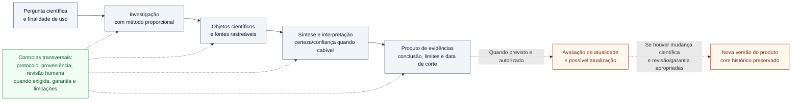

# Figura 1 — Visão geral do OES: esquema conceitual editável

**Estado:** PROTÓTIPO EDITORIAL NÃO APROVADO. Não integrado ao manuscrito; não constitui validação científica nem comprovação de execução operacional.
**Manuscrito-base:** [Fundamentos científicos, arquitetura metodológica e modelo de desenvolvimento](../oes-fundamentos-arquitetura-modelo-desenvolvimento.md), versão 0.46, sobretudo §1.4, §4.1 e §6.1.
**Plano:** [Plano editorial visual](../oes-plano-editorial-visual-manuscrito.md), Figura 1.
**Inserção proposta:** §1.4, depois da apresentação do encadeamento conceitual.
**Natureza:** desenho conceitual das funções propostas, não registro de capacidades plenamente operantes.

## Esquema editável (Mermaid)

**Leitura correta:** o fluxo sólido apresenta a arquitetura conceitual comum; **linhas tracejadas** representam acompanhamento e versionamento **condicionais**, não executados automaticamente. As ligações à faixa transversal indicam exigências de rastreabilidade e revisão nos pontos pertinentes, não etapas idênticas obrigatórias em todas as modalidades. A figura não afirma que cada produto requer síntese quantitativa, julgamento GRADE ou monitoramento persistente.

## Legenda proposta para o manuscrito

**Figura 1 — Organização conceitual proposta para o Observatório de Evidências em Saúde (OES).** A pergunta orienta uma investigação metodologicamente proporcional; fontes, estudos, relatórios, resultados e demais objetos científicos sustentam a interpretação e o produto comunicável. Acompanhamento, reavaliação e novas versões são condicionais e dependem de critérios e autorizações. **Os blocos não representam serviços necessariamente operacionais:** a Fase 4 permanece em desenvolvimento, M3 está bloqueado, e a validação científica independente do modelo não foi realizada na data de referência (20 de outubro de 2026). Fonte: elaboração editorial baseada nos Documentos 02, 04 e 40 do OES, em `STATE.md` e no checkpoint CP213.

## Texto alternativo proposto (acessibilidade)

“Fluxo conceitual, da esquerda para a direita: pergunta científica e finalidade de uso; investigação com método proporcional; objetos científicos e fontes rastreáveis; síntese e interpretação, incluindo certeza ou confiança quando cabível; produto de evidências, com conclusão, limites e data de corte. Uma conexão pontilhada, não obrigatória, segue para avaliação de atualidade e eventual nova versão mediante mudança científica, revisão e garantia apropriadas. Uma faixa transversal relaciona protocolo, proveniência, revisão humana quando exigida, garantia e limitações às etapas centrais.”

## Verificações antes de inserir no manuscrito

- [ ] Inspecionar visualmente o diagrama renderizado (quebras de linha, leitura em A4 e em preto e branco).
- [ ] Conferir a terminologia com os documentos canônicos de investigação, produtos, governança e atualização.
- [ ] Garantir que a condição de revisão independente para A3 não foi implicitamente satisfeita na figura.
- [ ] Conferir que monitoramento factual persistente e M3 não são apresentados como recursos já liberados.
- [ ] Ajustar a legenda e a referência cruzada no texto do Capítulo 1 apenas após aprovação editorial.
- [ ] Se houver exportação em SVG/PDF, verificar a legibilidade e o texto alternativo.

**Limite desta entrega:** foi produzido apenas o **esquema-fonte editável** para exame. Não há arquivo vetorial final, figura cientificamente aprovada ou inserção no manuscrito.
