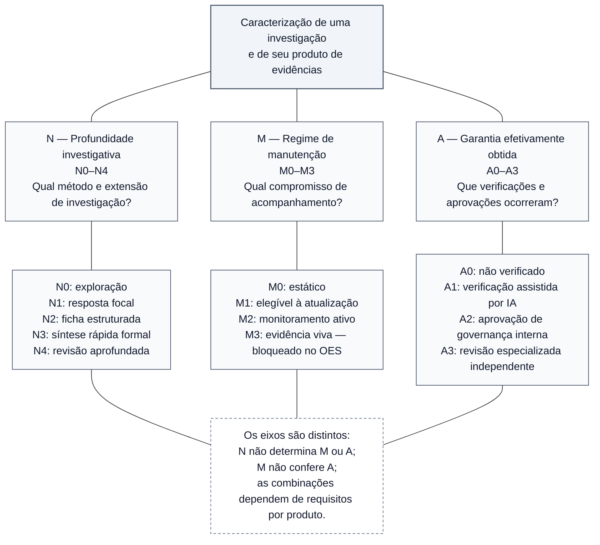

# Figura 2 — Dimensões N, M e A: protótipo conceitual editável

**Estado:** PROTÓTIPO EDITORIAL NÃO APROVADO. Não integrado ao manuscrito nem convertido em SVG.
**Manuscrito-base:** [Fundamentos científicos, arquitetura metodológica e modelo de desenvolvimento](../oes-fundamentos-arquitetura-modelo-desenvolvimento.md), versão **0.47**, especialmente §§4.2, 4.4, 4.5 e 7.3.
**Plano:** [Plano editorial visual do manuscrito](../oes-plano-editorial-visual-manuscrito.md), Figura 2.
**Local de inserção proposto:** §4.5 — *Independência entre profundidade e manutenção*.
**Objetivo:** permitir identificar **qual pergunta cada eixo responde** sem sugerir equivalência entre profundidade, atualidade e garantia.

## Esquema-fonte editável (Mermaid)

Três painéis em paralelo lógico: as ligações partem do conceito de **caracterização de um produto**, mas **não há setas entre N, M e A**, pois um eixo não determina automaticamente outro. A conveniência da orientação gráfica definitiva (painéis verticais ou lado a lado) será avaliada na renderização A4.

**Leitura obrigatória:** as ligações **sem setas** ilustram associação descritiva, não transição, causalidade, escala de mérito ou autorização para combinações arbitrárias. A representação dos códigos N/M/A é uma taxonomia **própria do OES**, não norma externa. Os níveis N3 e N4 têm requisitos formais de garantia humana especializada; para N4 há controles humanos adicionais. Um N4 aprofundado pode continuar A0 ou A1 enquanto não satisfizer o gate de publicação; isso **não o torna publicável**. A2 é aprovação interna, não revisão por pares nem A3. M3 está bloqueado no estado factual documentado, e a existência de contratos ou testes sintéticos em M2 não demonstra monitoramento factual sustentado.

## Legenda científica proposta

**Figura 2 — Três dimensões distintas da caracterização de evidências no OES.** A profundidade investigativa (N0–N4) descreve modalidade e exigências metodológicas; o regime de manutenção (M0–M3) caracteriza compromissos de acompanhamento; a garantia (A0–A3) representa verificações e aprovações efetivamente concluídas. Os eixos são conceitualmente independentes, mas **suas combinações estão sujeitas a requisitos e gates próprios de cada produto**. A2 não equivale à revisão científica independente A3, nem M3 está operacionalmente liberado. As taxonomias são específicas do OES e não constituem escala universal de qualidade ou maturidade. Fonte: Documentos 02, 04, 05 e 40 do OES, com estado de referência em `STATE.md` e CP213 (20/10/2026).

## Texto alternativo proposto

“Diagrama de três ramos que partem de uma investigação e seu produto. O ramo N descreve a profundidade ou modalidade investigativa, de N0 exploratório a N4 revisão aprofundada; M descreve manutenção, de M0 estático a M3 evidência viva, atualmente bloqueado; A descreve garantia efetivamente obtida, de A0 não verificado a A3 revisão humana especializada independente. Uma nota conecta os três ramos para afirmar que N não determina M ou A, que M não confere garantia e que políticas próprias dos produtos restringem as combinações. Não existem setas de progressão entre os eixos.”

## Conferências para a etapa gráfica

- [ ] Verificar, após renderização, se a leitura em A4 e em preto e branco distingue claramente os três painéis, sem elementos excessivamente pequenos.
- [ ] Evitar interpretação de progressão automática entre códigos e evitar falsa matriz integral de combinações possíveis.
- [ ] Manter o requisito de A3 para N3 formal e A3 com exigências adicionais de avaliadores para N4 formal.
- [ ] Preservar distinção entre GRADE (certeza da evidência) e A0–A3 (garantia de processo).
- [ ] Indicar M3 bloqueado no marco documental; não sugerir operação M2 factual sustentada.
- [ ] Conferir denominações específicas no Documento 02 (N), Documento 05 (M), Documento 04 (A) e Documento 40 (produtos) antes da arte final.
- [ ] Não modificar a tabela normativa de A0–A3 do Capítulo 7 nem a classificação N0–N4 da seção 4.2.
- [ ] Inserir no manuscrito somente após conferência semântica, legibilidade e aprovação editorial.

**Limite desta entrega:** esquema Mermaid editável e legenda propostos; nenhuma figura final, alteração no manuscrito, autorização operacional ou validação científica adicional.
