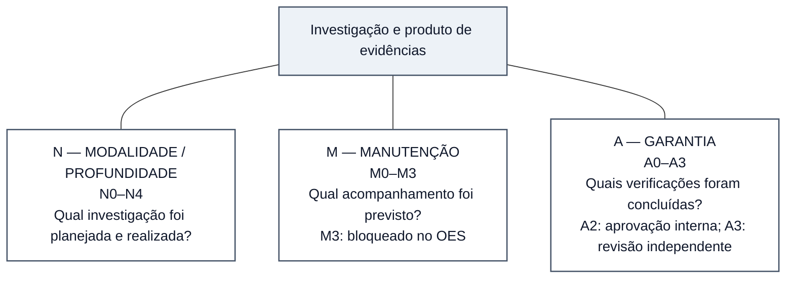

# Figura 2 — Dimensões N, M e A: protótipo conceitual editável

**Estado:** PROTÓTIPO EDITORIAL NÃO APROVADO. Não integrado ao manuscrito nem convertido em SVG.
**Manuscrito-base:** [Fundamentos científicos, arquitetura metodológica e modelo de desenvolvimento](../oes-fundamentos-arquitetura-modelo-desenvolvimento.md), versão **0.47**, especialmente §§4.2, 4.4, 4.5 e 7.3.
**Plano:** [Plano editorial visual do manuscrito](../oes-plano-editorial-visual-manuscrito.md), Figura 2.
**Local de inserção proposto:** §4.5 — *Independência entre profundidade e manutenção*.
**Objetivo:** permitir identificar **qual pergunta cada eixo responde** sem sugerir equivalência entre profundidade, atualidade e garantia.

## Esquema-fonte editável — versão revisada para composição A4

Três painéis **sem qualquer ligação direta entre si**, vinculados por traços simples a uma mesma caracterização científica. O esquema prioriza a **pergunta respondida por cada dimensão** e não reproduz as listas normativas das §§4.2 e 7.3. O uso de traços sem setas é intencional: não há progressão automática, dependência causal ou escala única de qualidade entre N, M e A.

**Leitura correta:** a disposição paralela indica que os três atributos caracterizam aspectos distintos de uma investigação e/ou de seu produto. **Não se deve interpretar os traços como setas ou caminhos de progressão**. A descrição abreviada “N0–N4” remete à tabela metodológica da §4.2; “A0–A3” remete à tabela de garantia da §7.3. Uma classificação N4 não autoriza publicação A0/A1; N3 formal requer A3, e N4 formal requer A3 e controles adicionais de revisores qualificados. O rótulo A3 só é legítimo após revisão humana especializada independente aprovativa. O regime M3 está bloqueado no estado documentado, e testes técnicos em M2 não equivalem a vigilância factual sustentada. **Certeza GRADE e garantia A são julgamentos diferentes**. A seleção de combinações depende da política própria de cada produto, e não de livre escolha entre todas as possibilidades matemáticas.

**Avaliação gráfica preliminar:** quatro caixas e três conexões diretas reduzem o risco de colisões, cruzamentos e fontes minúsculas. A orientação gráfica prevista é **vertical em página A4**, com três painéis de largura semelhante dispostos sob um cabeçalho; a configuração exata será definida na etapa SVG. **A legibilidade renderizada ainda não foi verificada**, portanto esta revisão não constitui aceite da figura final.

## Legenda científica proposta

**Figura 2 — Três dimensões distintas da caracterização de evidências no OES.** A profundidade investigativa (N0–N4) descreve modalidade e exigências metodológicas; o regime de manutenção (M0–M3) caracteriza compromissos de acompanhamento; a garantia (A0–A3) representa verificações e aprovações efetivamente concluídas. Os eixos são conceitualmente independentes, mas **suas combinações estão sujeitas a requisitos e gates próprios de cada produto**. A2 não equivale à revisão científica independente A3, nem M3 está operacionalmente liberado. As taxonomias são específicas do OES e não constituem escala universal de qualidade ou maturidade. Fonte: Documentos 02, 04, 05 e 40 do OES, com estado de referência em `STATE.md` e CP213 (20/10/2026).

## Texto alternativo proposto

“Diagrama conceitual com um bloco central denominado investigação e produto de evidências, ligado por traços simples, sem setas, a três painéis independentes. O painel N indica modalidade e profundidade investigativa N0–N4. O painel M indica regime de manutenção M0–M3 e registra M3 bloqueado. O painel A indica garantia A0–A3, distinguindo A2, aprovação interna, de A3, revisão humana especializada independente. Os painéis não se ligam entre si; a figura não representa progressão de mérito, validação científica geral nem combinações automaticamente permitidas.”

## Conferências para a etapa gráfica

- [ ] Verificar, após renderização, se a leitura em A4 e em preto e branco distingue claramente os três painéis, sem elementos excessivamente pequenos.
- [ ] Evitar interpretação de progressão automática entre códigos e evitar falsa matriz integral de combinações possíveis.
- [ ] Manter o requisito de A3 para N3 formal e A3 com exigências adicionais de avaliadores para N4 formal.
- [ ] Preservar distinção entre GRADE (certeza da evidência) e A0–A3 (garantia de processo).
- [ ] Indicar M3 bloqueado no marco documental; não sugerir operação M2 factual sustentada.
- [ ] Conferir denominações específicas no Documento 02 (N), Documento 05 (M), Documento 04 (A) e Documento 40 (produtos) antes da arte final.
- [ ] Não modificar a tabela normativa de A0–A3 do Capítulo 7 nem a classificação N0–N4 da seção 4.2.
- [ ] Inserir no manuscrito somente após conferência semântica, legibilidade e aprovação editorial.

**Resultado desta revisão:** semântica dos eixos e composição foram simplificadas no esquema editável; não se identificou fundamento para alterar os requisitos científicos do modelo. **Pendente:** renderização em SVG, inspeção de legibilidade em A4 e aprovação editorial anterior à inserção. Nenhuma alteração no manuscrito, autorização operacional ou validação científica adicional.
