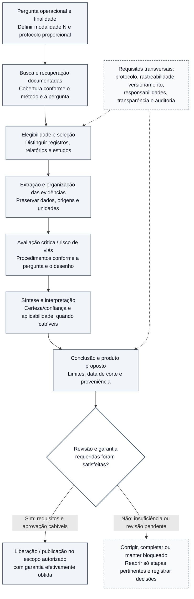

# Figura 3 — Fluxo metodológico de produção e revisão: protótipo editável

**Estado:** PROTÓTIPO EDITORIAL NÃO APROVADO — não integrado ao manuscrito, sem SVG final ou validação científica.
**Manuscrito-base:** [Fundamentos científicos, arquitetura metodológica e modelo de desenvolvimento](../oes-fundamentos-arquitetura-modelo-desenvolvimento.md), versão 0.48, especialmente §§5.1–5.10, 7.3–7.6 e 9.1–9.5.
**Plano:** [Plano editorial visual do manuscrito](../oes-plano-editorial-visual-manuscrito.md), Figura 3.
**Inserção proposta:** §5.1, após a apresentação do percurso metodológico. O Capítulo 9 deve remeter à figura, não duplicá-la.
**Natureza:** fluxo **de referência** orientado pela modalidade investigativa e pelos requisitos do produto, não prova de execução universal ou automatizada.

## Esquema editável (Mermaid)

As etapas científicas são apresentadas como um **percurso lógico adaptável**, não uma receita invariável. A decisão de garantia é um **ponto de controle**, não uma tarefa que possa ser considerada satisfeita por simples geração de texto ou aprovação técnica. A revisão pode exigir correções, limitar o uso ou bloquear publicação.

**Interpretação obrigatória:** as caixas expressam funções científicas que devem ser **adaptadas à pergunta, ao desenho, à cobertura e à modalidade N**. Avaliação crítica, síntese, certeza/confiança e aplicabilidade têm escopos distintos: a figura não declara GRADE obrigatório, busca exaustiva ou meta-análise em N0/N1. A ordem de extração e avaliação crítica é **esquemática**, podendo variar ou incluir iterações conforme o método; nenhum resultado de risco de viés se reduz a uma nota de qualidade genérica. O bloco de correção **não determina retorno obrigatório ao início**: a equipe identifica quais etapas devem ser reabertas e documenta a decisão. Um produto com revisão insuficiente permanece bloqueado, independentemente de sua completude editorial.

O ponto de controle G verifica **requisitos específicos do produto e decisões documentadas**, não um único selo universal. A0 não é publicável como produto científico final. A2 é aprovação **interna** e não representa avaliação científica independente; **N3 formal exige A3**, e **N4 formal exige A3 mais os controles humanos adicionais previstos**. A IA pode auxiliar a revisão interna A1; não substitui o avaliador humano qualificado exigido para A3. Testes de engenharia e um `PASS` isolado não autorizam inferências sobre qualidade científica ou operação sustentada. **A publicação só ocorre quando e no escopo em que a política do produto a permitir.**

A proveniência deve acompanhar **todas as etapas**; as linhas do bloco T apenas exemplificam essa transversalidade e não significam que somente E e C estejam sujeitas a controles. Os produtos transversais MAP/OVR e os produtos de manutenção têm contratos próprios; o fluxo não implica que todos sejam investigações sequenciais N0–N4. Este desenho não atribui ao OES validação independente ou prontidão operacional demonstrada.

## Legenda proposta

**Figura 3 — Percurso metodológico de referência para a produção de evidências no OES.** A pergunta e o protocolo determinam os procedimentos de busca, seleção, extração, avaliação crítica, síntese e interpretação proporcionais à modalidade investigativa. O produto proposto deve passar pelas verificações, revisões humanas e aprovações exigidas antes de sua liberação; pendências podem determinar correção ou bloqueio. Os controles de proveniência e transparência atravessam o percurso, e a avaliação da certeza/confiança aplica-se quando metodologicamente pertinente. **O fluxograma não certifica a execução integral desse percurso, não implica busca exaustiva ou meta-análise em todas as modalidades e não substitui requisitos específicos de A3.** Fonte: protocolos metodológicos do OES (Documentos 03 e 10–15), Documento 04 e arquitetura de produtos do Documento 40.

## Texto alternativo proposto

“Fluxograma vertical conceitual: pergunta científica e protocolo; busca documentada; elegibilidade e seleção; extração e organização; avaliação crítica; síntese e interpretação, com avaliação de certeza e aplicabilidade quando cabíveis; conclusão e produto proposto. Em seguida, um losango pergunta se a revisão e a garantia exigidas foram efetivamente satisfeitas. Se sim, há liberação no escopo autorizado; se não, corrigir, completar ou manter bloqueado, reabrindo apenas as etapas pertinentes. A sequência de extração e avaliação crítica é esquemática e pode incluir iterações. Controles de rastreabilidade e transparência se aplicam transversalmente.”

## Conferências antes do SVG e da inserção

- [ ] Verificar contra Documentos 03, 04, 10–15 e 40 os rótulos de cada etapa e a política aplicável a produtos distintos.
- [ ] Considerar diagrama A4 vertical, com separação nítida entre etapas científicas e decisão de garantia; reduzir rótulos se necessário, sem reduzir a correção científica.
- [ ] Evitar sugerir sequência obrigatória de extração e avaliação crítica quando métodos distintos justifiquem ordenação ou iteração próprias.
- [ ] Mostrar que um bloqueio pode decorrer tanto de insuficiência metodológica quanto de revisão especializada pendente.
- [ ] Não implicar que N0/N1 demandem revisão sistemática completa, meta-análise ou julgamento formal de certeza.
- [ ] Preservar distinção entre risco de viés, certeza da evidência e garantia do produto.
- [ ] Não apresentar aprovação A2 como revisão humana independente A3.
- [ ] Inspecionar renderização em preto e branco e A4, sem sobreposição de nós e sem microtipografia.
- [ ] Preparar SVG acessível com título e descrição; manter o Markdown como fonte de edição conceitual.
- [ ] Inserir no manuscrito apenas depois de avaliação gráfica/editorial; não modificar `STATE.md`, o banco, as fases ou os gates.

**Resultado da revisão:** ajustados o retorno após bloqueio e o caráter adaptável da sequência entre extração e avaliação crítica, sem alterar critérios científicos. **Pendente:** renderização e inspeção visual em A4, além de aprovação editorial antes da incorporação. Ainda não há SVG da Figura 3, alteração do manuscrito, aprovação científica ou execução operacional adicional.
