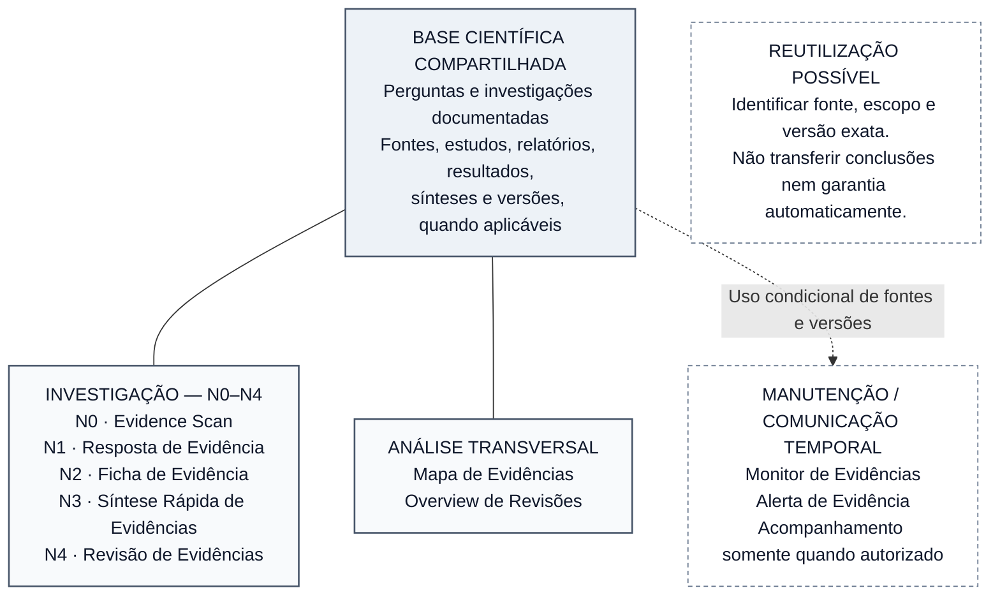

# Figura 4 — Arquitetura dos nove produtos do OES: protótipo editável

**Estado:** PROTÓTIPO EDITORIAL NÃO APROVADO — não integrado ao manuscrito, sem SVG final e sem validação científica adicional.
**Manuscrito-base:** [Fundamentos científicos, arquitetura metodológica e modelo de desenvolvimento](../oes-fundamentos-arquitetura-modelo-desenvolvimento.md), versão editorial **0.49**, especialmente §§6.1–6.6.
**Fonte normativa principal:** [Documento 40 — Taxonomia e Arquitetura dos Produtos](../../products/40-taxonomia-arquitetura-produtos.md), complementado pelos Documentos 02, 04 e 05.
**Plano:** [Plano editorial visual do manuscrito](../oes-plano-editorial-visual-manuscrito.md), Figura 4.
**Inserção proposta:** §6.1 — *Conceito e função dos produtos científicos*.
**Finalidade:** mostrar as três famílias e suas funções sem transformar os nove produtos em escada única, serviços já operacionais ou níveis automáticos de qualidade.

## Esquema-fonte editável — revisão semântica para A4

A representação foi simplificada para **uma base compartilhada e três painéis de produtos**. Cada painel apresenta a família e todos os seus integrantes, sem setas internas. Assim, a estrutura não sugere progressão N0 → N4, dependência entre famílias ou a necessidade de percorrer previamente a Ficha N2 para produzir um Mapa, uma Revisão ou um Overview. Uma nota separada explica a reutilização eventual de objetos e versões.

**Critério semântico:** ligações sólidas **sem ponta de seta** representam o vínculo informacional dos produtos de investigação e dos analíticos com os objetos científicos; não indicam ordem, pré-requisito sequencial, validação ou disponibilidade operacional. O vínculo pontilhado com a família de manutenção indica **funções previstas e condicionadas à autorização e à capacidade de acompanhamento**, sem afirmar que M2 execute vigilância factual contínua ou que M3 esteja liberado. A figura **não desenha ligação direta Monitor → Alerta**: um Alerta pode decorrer de um sinal cientificamente relevante avaliado e comunicado segundo seu contrato, e não constitui consequência automática de todo ciclo de Monitor.

**Produtos e métodos:** N0–N4 são modalidades de investigação com finalidades próprias, **não cinco passos obrigatórios**. MAP e OVR pertencem à análise transversal e não são níveis N adicionais. Monitor e Alerta pertencem à manutenção/comunicação temporal, e não criam N5. A Ficha N2 é a unidade persistente preferencial do OES, mas não é requisito universal para que os demais produtos existam. A base informacional é **compartilhável, não necessariamente idêntica**: cada produto utiliza apenas objetos pertinentes a seu método. Reutilização de evidências exige identificação da versão científica exata e reexame da adequação à nova pergunta; conclusões e garantias não se propagam automaticamente.

**Estado e garantia:** a arquitetura dos nove produtos foi formalizada documentalmente na Fase 3; **não** se conclui daí que todos estejam operacionais ou validados cientificamente. M3 permanece bloqueado; testes sintéticos de M2 não constituem comprovação de acompanhamento factual sustentado. A2 é aprovação interna e não equivale à revisão científica independente A3. Os produtos formais N3/N4 conservam os requisitos específicos de revisão especializada.

**Avaliação gráfica preliminar:** quatro nós principais e três conexões reduzem cruzamentos em comparação às nove linhas individuais do primeiro protótipo. Na versão vetorial, recomenda-se usar **três painéis independentes sob a base científica**, cada um com título e inventário próprio. A nota de reutilização pode permanecer em quadro separado **sem conectores**, preservando sua natureza geral. A disposição definitiva será avaliada em proporção A4, preto e branco, após renderização; esta revisão de estrutura **não equivale à inspeção do SVG**.

## Legenda científica proposta

**Figura 4 — Arquitetura conceitual dos nove produtos do Observatório de Evidências em Saúde.** Cinco produtos de investigação (N0–N4), dois analíticos transversais (Mapa e Overview) e dois de manutenção/comunicação temporal (Monitor e Alerta) são representados como modalidades distintas de uso de objetos científicos rastreáveis. A reutilização de evidências e versões é possível, mas **não constitui sequência obrigatória, propagação automática de conclusões ou equivalência de garantia**. As funções de monitoramento previstas não significam operação factual contínua; a validação científica externa do conjunto permanece pendente. Fonte: Documento 40, Documentos 02, 04 e 05 do OES e estado canônico de 20 de outubro de 2026.

## Texto alternativo proposto

“Diagrama com base informacional científica compartilhada no topo. Três conexões independentes levam às famílias: investigação, com Evidence Scan N0, Resposta N1, Ficha N2, Síntese Rápida N3 e Revisão N4; análise transversal, com Mapa de Evidências e Overview de Revisões; manutenção temporal, com Monitor e Alerta, apenas quando previstos e autorizados. Os cinco níveis N são modalidades, não etapas obrigatórias. Um quadro separado informa que objetos e versões podem ser reutilizados mediante rastreabilidade, sem transmitir automaticamente conclusões ou garantia. A figura não comprova operação contínua nem validação externa.”

## Conferências antes de produzir o SVG

- [ ] Conferir todos os **nove nomes** e agrupamentos com o Documento 40.
- [ ] Verificar visualmente a independência das três famílias, evitando hierarquia de qualidade e progressão N0 → N4.
- [x] Reduzir a ligação da base compartilhada a **um vínculo por família**; no SVG, manter três painéis sem conexões internas ou hierarquia entre produtos.
- [ ] Preservar o vínculo condicional entre Monitor e Alerta; Alerta não equivale automaticamente à nova síntese.
- [ ] Não representar todos os produtos como ativos em produção nem sugerir M3 liberado.
- [ ] Não confundir nível N de investigação, regime M de manutenção e garantia A de revisão.
- [ ] Conferir contraste e tipografia em página A4, escala de leitura real e preto e branco.
- [ ] Manter fontes editáveis, SVG com título/descrição acessíveis e prova de renderização antes da inserção.
- [ ] Após a conferência gráfica e aprovação editorial, inserir apenas na §6.1 e verificar a íntegra das 56 referências do manuscrito.

**Resultado desta revisão:** classificação e funções dos nove produtos preservadas; conectividade simplificada para três famílias, com reutilização representada sem dependências artificiais. **Pendências:** gerar SVG, inspecionar a renderização A4 e obter aprovação editorial antes de integrar o manuscrito. Nenhuma modificação do manuscrito, validação externa ou operação de produtos.
