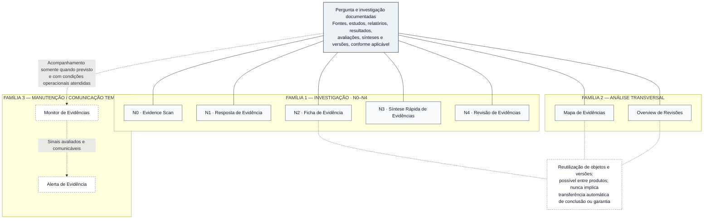

# Figura 4 — Arquitetura dos nove produtos do OES: protótipo editável

**Estado:** PROTÓTIPO EDITORIAL NÃO APROVADO — não integrado ao manuscrito, sem SVG final e sem validação científica adicional.
**Manuscrito-base:** [Fundamentos científicos, arquitetura metodológica e modelo de desenvolvimento](../oes-fundamentos-arquitetura-modelo-desenvolvimento.md), versão editorial **0.49**, especialmente §§6.1–6.6.
**Fonte normativa principal:** [Documento 40 — Taxonomia e Arquitetura dos Produtos](../../products/40-taxonomia-arquitetura-produtos.md), complementado pelos Documentos 02, 04 e 05.
**Plano:** [Plano editorial visual do manuscrito](../oes-plano-editorial-visual-manuscrito.md), Figura 4.
**Inserção proposta:** §6.1 — *Conceito e função dos produtos científicos*.
**Finalidade:** mostrar as três famílias e suas funções sem transformar os nove produtos em escada única, serviços já operacionais ou níveis automáticos de qualidade.

## Esquema-fonte editável (Mermaid)

O desenho distingue **uma base científica compartilhada** dos **produtos de comunicação/representação**. As ligações entre a base e as famílias indicam dependência informacional, não que cada produto empregue necessariamente todos os tipos de objeto ou procedimentos de síntese.

**Critério semântico:** as conexões sólidas sem ponta de seta representam relação entre o acervo científico e os produtos. As conexões pontilhadas **não** demonstram passagem obrigatória entre famílias, nem produção automática de Alertas. O desenho não contém ligações N0 → N1 → N2 → N3 → N4 porque essa sequência é **possível, não obrigatória**. Monitor e Alerta são produtos da família de manutenção, **não níveis N adicionais**. Mapa e Overview são produtos transversais, com métodos próprios, e **não** correspondem necessariamente a um nível de profundidade N0–N4.

A Ficha N2 é a unidade persistente preferencial do projeto, mas essa decisão não reduz o valor científico de outras formas de produção; objetos, sínteses e versões podem ser reutilizados somente com rastreabilidade de fonte, escopo, julgamento e **versão exata**. Um novo sinal do Monitor não modifica conclusões automaticamente. A vigência de M3 continua bloqueada, enquanto os testes sintéticos de M2 **não comprovam vigilância factual contínua**. A2 representa aprovação interna e **não** a revisão científica independente A3; os produtos formais N3/N4 mantêm exigências próprias de garantia e revisão humana.

**Alerta de precisão:** a arquitetura técnica e documental de nove produtos foi formalizada na Fase 3; isso não demonstra que todos estejam disponíveis ao público, tenham sido validados cientificamente ou operem de modo contínuo. A figura retrata o **portfólio conceitual**, não o inventário de produtos operacionalmente liberados.

## Legenda científica proposta

**Figura 4 — Arquitetura conceitual dos nove produtos do Observatório de Evidências em Saúde.** Cinco produtos de investigação (N0–N4), dois analíticos transversais (Mapa e Overview) e dois de manutenção/comunicação temporal (Monitor e Alerta) são representados como modalidades distintas de uso de objetos científicos rastreáveis. A reutilização de evidências e versões é possível, mas **não constitui sequência obrigatória, propagação automática de conclusões ou equivalência de garantia**. As funções de monitoramento previstas não significam operação factual contínua; a validação científica externa do conjunto permanece pendente. Fonte: Documento 40, Documentos 02, 04 e 05 do OES e estado canônico de 20 de outubro de 2026.

## Texto alternativo proposto

“Diagrama com base científica compartilhada composta por pergunta, investigação, fontes, estudos, relatórios, resultados, avaliações, sínteses e versões quando pertinentes. A base relaciona-se a três famílias: cinco produtos de investigação N0 Evidence Scan, N1 Resposta de Evidência, N2 Ficha de Evidência, N3 Síntese Rápida e N4 Revisão; dois produtos transversais Mapa de Evidências e Overview de Revisões; dois produtos temporais Monitor e Alerta. Linhas pontilhadas identificam acompanhamento condicional e possibilidades de reutilização de objetos com rastreabilidade, sem impor sequência ou progressão científica.”

## Conferências antes de produzir o SVG

- [ ] Conferir todos os **nove nomes** e agrupamentos com o Documento 40.
- [ ] Verificar visualmente a independência das três famílias, evitando hierarquia de qualidade e progressão N0 → N4.
- [ ] Avaliar se as ligações da base compartilhada criam cruzamentos excessivos; no SVG, priorizar **um barramento comum por família** em vez de nove linhas diretas.
- [ ] Preservar o vínculo condicional entre Monitor e Alerta; Alerta não equivale automaticamente à nova síntese.
- [ ] Não representar todos os produtos como ativos em produção nem sugerir M3 liberado.
- [ ] Não confundir nível N de investigação, regime M de manutenção e garantia A de revisão.
- [ ] Conferir contraste e tipografia em página A4, escala de leitura real e preto e branco.
- [ ] Manter fontes editáveis, SVG com título/descrição acessíveis e prova de renderização antes da inserção.
- [ ] Após a conferência gráfica e aprovação editorial, inserir apenas na §6.1 e verificar a íntegra das 56 referências do manuscrito.

**Limite desta atividade:** somente protótipo conceitual editável e especificação científica. Sem SVG produzido, modificação do manuscrito, validação externa ou operação de produtos.
