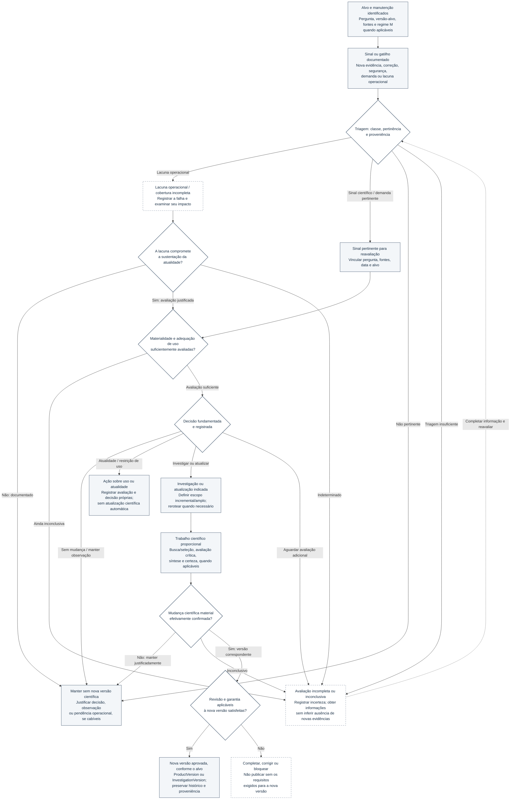

# Figura 5 — Decisão de atualizar evidências: protótipo editável

**Estado:** PROTÓTIPO COM REVISÃO SEMÂNTICA INTERNA — não aprovado para publicação; sem SVG, incorporação ao manuscrito ou validação científica externa.
**Manuscrito-base:** [Fundamentos científicos, arquitetura metodológica e modelo de desenvolvimento](../oes-fundamentos-arquitetura-modelo-desenvolvimento.md), versão **0.50**, §§10.1–10.7.
**Local de inserção proposto:** §10.4 (*Avaliação da relevância das novas informações*), com remissão à tabela de estados de atualidade da §10.2.
**Fonte primária:** [Documento 05 — Protocolo Transversal de Atualização](../../governance/05-protocolo-transversal-atualizacao.md), complementado pelos Documentos 04 e 40 e pelo estado canônico do OES.
**Intenção:** diferenciar identificação de sinais, avaliação de impacto, decisão autorizada, trabalho científico e eventual versionamento — sem caracterizar as atividades previstas como serviço de vigilância factual contínua.

## Diagrama conceitual editável (Mermaid)

## Leitura obrigatória e limites

1. **Alvo, política e sinal são coisas distintas.** A pergunta, o alvo versionado, as fontes previstas, o regime M e seus limites de cobertura devem ser identificados quando aplicáveis. O fluxograma é conceitual: não afirma que haja monitoramento factual recorrente em operação, nem exige busca programada em M0/M1.
2. **Sinal não significa mudança científica.** Estudo novo, correção, retratação, sinal de segurança, demanda e falha de fonte não são equivalentes. Monitor identifica candidatos e lacunas; Alerta comunica um evento; nenhum deles modifica automaticamente as conclusões da versão-alvo. Triagem inconclusiva não equivale a sinal inexistente.
3. **A lacuna operacional possui avaliação prévia própria.** Um ciclo incompleto não permite concluir que não surgiu evidência e tampouco muda automaticamente `currentness`. Apenas impacto materialmente relevante e documentado na sustentação da atualidade pode justificar uma avaliação específica da ProductVersion. Obrigações operacionais pendentes continuam registradas mesmo quando não se recomenda atualização científica.
4. **Materialidade não se confunde com novidade nem direção do efeito.** Examinar benefício, dano, magnitude, precisão, certeza/confiança, aplicabilidade, integridade, escopo, status regulatório, método e conclusão. Os resultados incluem ausência de mudança material identificada, mudança potencial ou confirmada, ameaça ao uso e informação insuficiente.
5. **Saídas não são mutuamente exclusivas.** Manter a versão, continuar observando, reavaliar `currentness`, restringir uso e iniciar investigação ou atualização podem coexistir sob decisões distintas e justificadas. A decisão de não atualizar cientificamente pode ser legítima. O diagrama não define nem automatiza transições da máquina de estados de `product.currency_state` (ver §10.2 e Documento 05).
6. **Iniciar investigação não comprova mudança material.** Mesmo após busca e avaliação científica proporcionais, pode não haver alteração material a versionar; essa conclusão deve ser registrada. Informação insuficiente mantém a avaliação inconclusiva, sem autorizar publicação automática ou conclusão sobre ausência de novas evidências.
7. **Garantia e versionamento pertencem ao alvo e à nova versão.** Quando houver mudança material, criar `ProductVersion` ou `InvestigationVersion` conforme o objeto efetivamente modificado; não criar `ProductVersion` artificial quando apenas a investigação muda. Novos produtos derivados exigem seus próprios gates. A2 é aprovação interna; A3 exige revisão independente qualificada; N3/N4 formais preservam requisitos próprios. Garantia anterior não é herdada e um `PASS` técnico isolado não supre revisão científica.
8. **Retorno e decisões não são automações autoritativas.** A seta pontilhada indica completar informações e retomar a etapa pertinente (triagem, avaliação de lacuna ou materialidade); não impõe ciclo automático ou SLA aprovado. Decisões de atualidade, restrição de uso, conteúdo e publicação requerem os registros, atores e autorizações correspondentes.
9. **Estado de implementação:** M2 foi objeto de testes sintéticos, sem demonstração de vigilância factual contínua, e M3 permanece bloqueado no estado canônico documentado. A figura não representa operação sustentada nem uma garantia científica A3 obtida.

## Legenda científica proposta

**Figura 5 — Fluxo decisório proposto para reavaliação e atualização de evidências no OES.** A partir do alvo e da política de manutenção aplicável, sinais pertinentes e lacunas operacionais recebem triagens distintas antes da avaliação de materialidade e da decisão documentada. A decisão pode manter a versão, requerer avaliação adicional, alterar justificadamente a avaliação de atualidade ou de uso, ou iniciar trabalho científico; este último não implica necessariamente mudança material confirmada. A nova versão depende da alteração efetiva do objeto científico e do cumprimento dos requisitos pertinentes de revisão e garantia, com preservação do histórico. O esquema não estabelece transições automáticas de `currentness`, nem comprova vigilância factual contínua ou funcionamento de M3. Fontes: Documentos 05, 04 e 40; manuscrito §§10.2–10.6; estado canônico do OES (20/10/2026).

## Texto alternativo proposto

“Fluxograma conceitual de reavaliação das evidências. Identificados o objeto, a versão e o regime de manutenção aplicável, um sinal documentado é triado. Lacunas operacionais são registradas e avaliadas quanto ao impacto na sustentação da atualidade, sem presumir ausência de novos estudos. Sinais científicos e demandas pertinentes seguem para exame de materialidade; avaliações insuficientes exigem complementação. A decisão registrada pode manter a versão, reavaliar atualidade ou uso, ou iniciar investigação científica. Após o trabalho científico, verifica-se se ocorreu mudança material: se não, registra-se a manutenção; se sim, uma nova versão depende dos requisitos correspondentes de revisão e garantia, preservando-se a anterior. O diagrama não representa atualização automática nem monitoramento factual contínuo.”

## Conferências antes do SVG

- [x] Confrontar decisões, estados `currency_state` e gatilhos com o Documento 05, sem criar transições automáticas ou estados adicionais.
- [x] Separar sinal científico, demanda de reavaliação e falha operacional; não equiparar ciclo incompleto à ausência de estudos ou à mudança automática de atualidade.
- [x] Distinguir manutenção justificada, avaliação inconclusiva, avaliação de uso/atualidade e investigação/atualização científica.
- [x] Tornar explícito que investigação adicional pode não confirmar mudança científica material.
- [x] Condicionar nova versão a objeto efetivamente alterado, revisão/garantia aplicáveis e decisão registrada; não representar IA como aprovadora autônoma.
- [ ] Ajustar disposição espacial, número de cruzamentos e legibilidade para A4 vertical, mantendo as bifurcações semânticas necessárias.
- [ ] Produzir SVG vetorial com título e descrição acessíveis, contrastes e leitura em preto e branco.
- [ ] Renderizar e inspecionar efetivamente o SVG antes de qualquer afirmação de legibilidade gráfica.
- [ ] Inserir somente na §10.4 após inspeção gráfica, com verificação de integridade do manuscrito e remissão à §10.2.

**Limite desta entrega:** revisão semântica editorial do protótipo, sem aprovação científica externa; nenhuma alteração em `STATE.md`, gates, fases, banco, serviços externos ou manuscrito.
