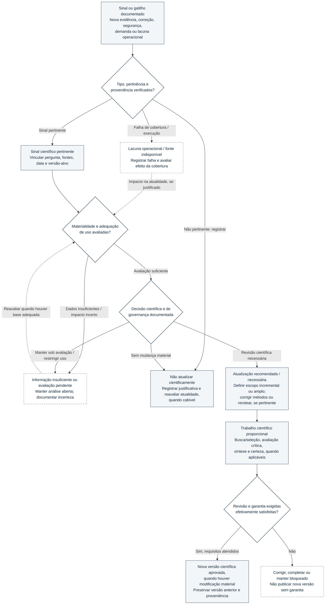

# Figura 5 — Decisão de atualizar evidências: protótipo editável

**Estado:** PROTÓTIPO EDITORIAL NÃO APROVADO — sem SVG, incorporação ao manuscrito ou validação científica externa.
**Manuscrito-base:** [Fundamentos científicos, arquitetura metodológica e modelo de desenvolvimento](../oes-fundamentos-arquitetura-modelo-desenvolvimento.md), versão **0.50**, §§10.1–10.7.
**Local de inserção proposto:** §10.4 (*Avaliação da relevância das novas informações*), com remissão à tabela de estados de atualidade da §10.2.
**Fonte primária:** [Documento 05 — Protocolo Transversal de Atualização](../../governance/05-protocolo-transversal-atualizacao.md), complementado pelos Documentos 04 e 40 e pelo estado canônico do OES.
**Intenção:** diferenciar identificação de sinais, avaliação de impacto, decisão autorizada, trabalho científico e eventual versionamento — sem caracterizar as atividades previstas como serviço de vigilância factual contínua.

## Diagrama conceitual editável (Mermaid)

## Leitura obrigatória e limites

1. **Sinal não significa atualização.** A descoberta de novo estudo, uma retratação, um alerta e a falha de uma fonte são ocorrências diferentes. Um Monitor identifica candidatos e lacunas; um Alerta comunica a necessidade potencial de atenção; nenhum deles altera automaticamente conclusões.
2. **Falha de cobertura não equivale à ausência de novas evidências.** Seu impacto sobre `currentness` é avaliado caso a caso. A falha não impõe automaticamente `outdated` ou `under_evaluation`.
3. **Materialidade não equivale à novidade.** A avaliação examina efeitos sobre benefício, dano, magnitude, precisão, risco de viés, certeza/confiança, aplicabilidade, integridade, escopo e conclusão. Uma informação insuficiente pode exigir análise adicional; não força uma decisão binária.
4. **Decisões podem não envolver nova versão.** O resultado pode ser manutenção justificada da versão, monitoramento/reavaliação adicional, recomendação de atualização, restrição do uso corrente ou investigação mais ampla. Mudanças de `currency_state` exigem avaliação e registro próprios, conforme §10.2; a figura **não especifica transições automáticas** da máquina de estados.
5. **Versão científica exige trabalho e garantia.** Uma modificação material aprovada pode gerar `ProductVersion` nova, preservando a anterior. Se o alvo for exclusivamente `InvestigationVersion`, não se cria artificialmente uma `ProductVersion`. Revisões e garantias **não são herdadas** de uma versão anterior: A2 interno não equivale a A3 independente.
6. **Retornos são conceituais.** A seta pontilhada de avaliação pendente para materialidade indica necessidade eventual de completar informações, sem ciclo automático, SLA aprovado ou obrigação de recomeçar integralmente. A estrutura visa apoiar decisão humana/autorizações cabíveis.
7. **Estado de implementação:** M2 recebeu testes sintéticos, que não comprovam vigilância factual contínua; **M3 está bloqueado**. O desenho não afirma serviço de monitoramento ativo, classificação autoritativa automatizada ou aprovação científica externa alcançada.

## Legenda científica proposta

**Figura 5 — Fluxo decisório proposto para atualização de evidências no OES.** A identificação de sinais científicos ou de lacunas operacionais é seguida da verificação de pertinência, proveniência e materialidade. A decisão documentada pode manter a versão, requerer avaliação adicional, restringir seu uso ou iniciar atualização científica proporcional; a liberação de nova versão depende dos métodos e da garantia exigidos, com preservação do histórico. O fluxo não estabelece transições automáticas de atualidade, nem comprova vigilância factual contínua ou funcionamento de M3. Fonte: Documento 05 — Protocolo Transversal de Atualização; Documentos 04 e 40; estado canônico do OES (20/10/2026).

## Texto alternativo proposto

“Fluxograma decisório da atualização de evidências. Um sinal documentado passa por verificação de origem e pertinência. Falhas operacionais são registradas e avaliadas quanto ao impacto de cobertura; sinais científicos pertinentes passam à avaliação de materialidade. Quando há informação insuficiente, a avaliação permanece pendente. A decisão documentada pode manter a versão sem atualização científica, requerer nova análise ou iniciar atualização. Neste último caso, a equipe realiza o trabalho metodológico aplicável e verifica a garantia exigida: somente com requisitos satisfeitos surge uma nova versão aprovada, preservando a anterior; caso contrário, a publicação permanece bloqueada.”

## Conferências antes do SVG

- [ ] Confrontar explicitamente decisões, `currency_state` e gatilhos com o Documento 05, evitando transições de estado inventadas.
- [ ] Conferir que uma falha operacional não seja tratada como sinal científico positivo, ausência de estudos, nem mudança automática da atualidade.
- [ ] Representar sem cruzamentos excessivos as alternativas **sem atualização**, **avaliação adicional** e **atualização científica**.
- [ ] Evitar um losango de decisão que sugira atualização por IA sem autorização e garantia apropriadas.
- [ ] Distinguir mudança da versão científica e eventual mudança na avaliação de atualidade.
- [ ] Considerar A4 vertical, legibilidade em preto e branco, título e descrição acessíveis.
- [ ] Conservar o protótipo como referência de edição conceitual antes de produzir SVG e conferir a renderização.
- [ ] Inserir somente na §10.4 após revisão semântica, gráfica e verificação de integridade do manuscrito.

**Limite desta entrega:** documento editorial de planejamento, sem atualização de `STATE.md`, gates, fases, banco, serviços externos ou manuscrito.
