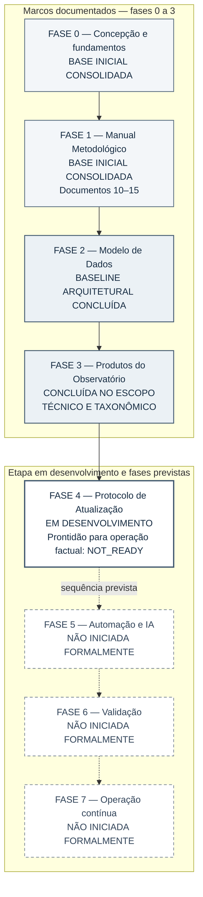

# Figura 6 — Desenvolvimento temporal do OES: protótipo editável

**Estado:** PROTÓTIPO COM REVISÃO SEMÂNTICA INTERNA CONCLUÍDA — ainda não aprovado para publicação; sem SVG, inspeção gráfica ou integração ao manuscrito.
**Data de referência dos estados:** **20 de outubro de 2026** (snapshot documental; não representa atualização automática do estado atual).
**Manuscrito-base:** [Fundamentos científicos, arquitetura metodológica e modelo de desenvolvimento](../oes-fundamentos-arquitetura-modelo-desenvolvimento.md), versão editorial **0.51**, §12.1.
**Local proposto de inserção:** imediatamente após a tabela de fases da §12.1, para evidenciar a diferença entre conclusão documental/técnica, desenvolvimento em curso e etapas ainda não iniciadas.
**Fontes principais:** [STATE.md](../../../STATE.md), [ponteiro de continuidade](../../../archive/handoffs/oes/README.md) e [CP213](../../../archive/handoffs/oes/OES_Continuidade_2026-10-20_CP213.md); nomenclatura das fases no [Documento 00](../../governance/00-documento-de-concepcao.md); especificação no [plano editorial visual](../oes-plano-editorial-visual-manuscrito.md).
**Função editorial:** apresentar uma trajetória de desenvolvimento em oito fases, com **estados nomeados**, sem simular medição de maturidade, progresso percentual, operação sustentada ou validação científica independente.

## Diagrama conceitual editável (Mermaid)

**Convenção de leitura:** setas contínuas entre as fases 0–4 indicam a **sucessão de fases documentadas** (0–3 com marcos específicos e 4 iniciada, ainda em desenvolvimento), não a satisfação automática de requisitos ou *gates*. As setas pontilhadas entre as fases 4–7 indicam apenas **sequência planejada**: 5–7 não foram formalmente iniciadas, e nenhuma transição futura está autorizada pelo diagrama. Os rótulos textuais de estado são obrigatórios; espessura, posição e cores não medem maturidade, qualidade, duração ou percentual de conclusão.

## Leitura científica e limites de interpretação

1. **Fases 0–1:** a expressão *base inicial consolidada* se refere à concepção e ao corpo inicial de protocolos. Não significa conclusão definitiva de todos os métodos nem revisão científica independente.
2. **Fase 2:** a conclusão ocorre no **nível de baseline arquitetural** (OES-P1), com testes e decisões técnicas próprios. Não é congelamento de esquema de produção, escolha definitiva de infraestrutura ou validação científica global.
3. **Fase 3:** o encerramento foi realizado **no escopo técnico e taxonômico definido**, não como demonstração de publicação ou validação homogênea de todos os produtos. Não transforma todos os produtos em saídas publicáveis ou independentemente validadas: há produtos internos A2, casos em revisão, N3 experimental A0 bloqueado e N4 formal não iniciado/NOT_READY, conforme a documentação específica.
4. **Fase 4:** permanece **em desenvolvimento**; o estado de prontidão para operação factual é **NOT_READY** no CP213. Isso não significa que o trabalho conceitual ou os testes técnicos da fase estejam ausentes. Testes sintéticos de M2 não demonstram vigilância contínua com evidências reais; M3 permanece bloqueado. O registro CP213 identifica B1R1 como `EXPIRED_NOT_EXECUTED`, não medição factual executada.
5. **Fases 5–7:** **não iniciadas formalmente** na data de referência. A existência anterior de protótipos, scripts, verificações por IA ou experimentos não deve ser redescrita como abertura formal da Fase 5, início da validação independente na Fase 6 ou operação da Fase 7.
6. **Não há escala quantitativa implícita:** o tamanho e a posição dos blocos não representam duração, esforço, custos, progresso percentual, eficácia ou qualidade científica. A numeração indica fases propostas, não aumento automático de maturidade.
7. **Situação temporal:** os estados correspondem à documentação canônica referida a **20/10/2026**. Qualquer alteração factual futura deverá ser verificada em `STATE.md`, no ponteiro de continuidade e no histórico de Git antes da publicação ou reutilização.
8. **Escopo editorial:** a figura descreve o desenvolvimento do OES. Não autoriza execução de fases, alterações no Neon, liberação de *gates*, serviços pagos ou mudanças no projeto.

## Legenda científica proposta

**Figura 6 — Trajetória documental e técnica do desenvolvimento do Observatório de Evidências em Saúde (OES), conforme os estados registrados em 20 de outubro de 2026.** As fases 0 e 1 apresentam bases iniciais consolidadas; a Fase 2 está concluída no nível de baseline arquitetural; e a Fase 3, no escopo técnico e taxonômico definido. A Fase 4 permanece em desenvolvimento, com prontidão para operação factual **NOT_READY**; as fases 5, 6 e 7 não foram formalmente iniciadas. As conexões contínuas representam a sucessão documentada até a Fase 4; as pontilhadas, apenas etapas planejadas. A figura **não representa duração, progresso percentual, aprovação automática de *gates*, validação científica independente ou operação contínua demonstrada**. Fontes: `STATE.md`, CP213 e Documento 00 do OES.

## Texto alternativo proposto

“Diagrama da sequência de oito fases de desenvolvimento do OES. A Fase 0, concepção, e a Fase 1, manual metodológico, estão marcadas como bases iniciais consolidadas. A Fase 2, modelo de dados, está concluída como baseline arquitetural; a Fase 3, produtos, está concluída no escopo definido. A Fase 4, protocolo de atualização, está em desenvolvimento, mas sua prontidão para operação factual consta como NOT_READY. As fases 5, automação e IA; 6, validação; e 7, operação contínua, estão marcadas como não iniciadas formalmente e unidas por conexões pontilhadas de planejamento. O diagrama não representa percentuais de avanço nem validação científica independente.”

## Conferências para a etapa de revisão semântica

- [x] Confirmar que cada rótulo de fase corresponde ao significado registrado na §12.1, no `STATE.md` e no CP213 na data de referência, preservando diferenças de escopo.
- [x] Diferenciar nas setas a sucessão documental de fases 0–4 e o planejamento das fases 5–7, sem afirmar passagem de *gates*.
- [x] Verificar que a conclusão das fases 2–3 tem escopo limitado e não significa validação científica independente ou prontidão operacional.
- [x] Preservar a distinção entre testes sintéticos M2, M3 bloqueado, B1R1 `EXPIRED_NOT_EXECUTED` e operação factual não demonstrada.
- [ ] Avaliar legibilidade em A4 e leitura em preto e branco; considerar dividir a linha em dois segmentos sem alterar a ordem 0–7.
- [ ] Na fase vetorial posterior, criar SVG acessível com título e descrição, renderizar e inspecionar a imagem efetiva.
- [ ] Somente após revisões, integrar à §12.1 sem alterar as 56 referências ou as figuras anteriores.

**Limite desta entrega:** revisão semântica interna do protótipo conceitual; não constitui aprovação científica externa, inspeção gráfica ou autorização para execução operacional. Sem modificação do manuscrito, `STATE.md`, continuidade operacional, *gates*, banco de dados ou serviços externos.
