# Figura 7 — Evidência produzida e limite de inferência: protótipo editável

**Estado:** PROTÓTIPO COM REVISÃO SEMÂNTICA INTERNA CONCLUÍDA — sem aprovação científica externa, SVG, inspeção gráfica ou integração.
**Data de referência:** 20 de outubro de 2026; estado datado, não uma certificação atual.
**Manuscrito-base:** [Fundamentos científicos, arquitetura metodológica e modelo de desenvolvimento](../oes-fundamentos-arquitetura-modelo-desenvolvimento.md), versão **0.52**, especialmente §§13.1, 13.5 e 7.3.
**Inserção prevista:** §13.1 — *Dimensões de validação*, após a exposição textual, sem substituir a discussão das cinco dimensões.
**Fontes:** [Documento 04](../../governance/04-governanca-garantia-revisao.md), [STATE.md](../../../STATE.md), [CP213](../../../archive/handoffs/oes/OES_Continuidade_2026-10-20_CP213.md) e [plano editorial visual](../oes-plano-editorial-visual-manuscrito.md).

## Matriz semântica de referência

As seis linhas descrevem **controles diferentes**, não seis degraus da mesma escala ou correspondência um a um com as **cinco dimensões de validação** da §13.1. Os registros podem expressar verificação realizada ou requisito cuja aprovação não foi demonstrada nos casos examinados.

| Controle e situação documentada | Objeto ou requisito examinado | Evidência registrada ou situação documentada | Limite inferencial |
|---|---|---|---|
| **Revisão documental** — realizada em escopos delimitados | Protocolos, definições, taxonomia e especificações | Revisões e decisões internas documentadas | Coerência documental não demonstra correta execução metodológica nem validade das conclusões |
| **Engenharia e PoC** — testes em escopos delimitados | Modelo de dados, contratos, regras técnicas, simulações e renderização | Resultados `PASS` nos cenários examinados | `PASS` técnico não é `PASS` científico; teste sintético não prova operação factual sustentada |
| **Verificação adversarial assistida por IA** — realizada em alguns casos, com resultados distintos | Consistência metodológica, julgamentos e rastreabilidade examinados | `passed` ou `revise` conforme o caso; A1 apenas se satisfeitos os requisitos ativos | IA não constitui *expert review* independente; `revise` não promove A1 |
| **Governança do proprietário (A2)** — alcançada em produtos internos específicos | Escopo, divulgação de limitações, governança e autorização aplicável | A2 documentado em N1 e N2, após A1 e aprovação do proprietário | Não equivale a julgamento especializado de ROBIS, RoB 2 ou GRADE, nem implica A3 |
| **Revisão especializada independente (A3)** — não demonstrada nos casos descritos | Revisão qualificada independente das decisões científicas/metodológicas | Requisito previsto no Documento 04; nenhuma aprovação A3 demonstrada nos casos examinados | Não inferir A3 de A2 ou IA; N3 formal exige A3 e controles pertinentes; N4 formal requer A3 e controles humanos adicionais. A3 não valida toda a plataforma |
| **Prontidão para liberação operacional factual** — `NOT_READY` | Infraestrutura, permissões, fontes factuais, falhas e sustentação | M2 sintético histórico e pendências documentadas; prontidão operacional factual da Fase 4 `NOT_READY`; M3 bloqueado | Não comprova monitoramento factual contínuo nem liberação operacional; B1R1 `EXPIRED_NOT_EXECUTED` |

**Nota de classificação:** A0–A3 registram etapas de garantia **de versões específicas**, mediante decisões ativas válidas; não são categorias de certeza GRADE. A Fase 6 trata da validação global do OES e **não estava formalmente iniciada** em 20/10/2026. Mesmo uma aprovação A3 futura não validaria automaticamente a plataforma nem todas as conclusões.

## Diagrama conceitual editável

A leitura de cada linha é **objeto/requisito → evidência registrada ou estado documentado → limite inferencial**. As linhas de A3 e prontidão factual descrevem condições **não demonstradas**, não aprovações efetivas.

```mermaid
flowchart TB
    subgraph R1["01 · Revisão documental · realizada em escopos delimitados"]
        direction LR
        D1["OBJETO<br/>Conceitos, protocolos e taxonomia"]
        E1["EVIDÊNCIA<br/>Documentos e decisões revisados internamente"]
        L1["LIMITE<br/>Não valida conclusões científicas"]
        D1 --> E1 --> L1
    end
    subgraph R2["02 · Engenharia e provas de conceito · testes delimitados"]
        direction LR
        D2["OBJETO<br/>Contratos, dados e cenários técnicos"]
        E2["EVIDÊNCIA<br/>PASS técnico onde efetivamente testado"]
        L2["LIMITE<br/>Não certifica ciência nem operação factual"]
        D2 --> E2 --> L2
    end
    subgraph R3["03 · Verificação adversarial por IA · casos específicos"]
        direction LR
        D3["OBJETO<br/>Consistência e rastreabilidade metodológica"]
        E3["EVIDÊNCIA<br/>passed ou revise, conforme o caso"]
        L3["LIMITE<br/>Não é revisão humana independente"]
        D3 --> E3 --> L3
    end
    subgraph R4["04 · Governança do proprietário A2 · produtos internos"]
        direction LR
        D4["OBJETO<br/>Escopo, transparência e autorização"]
        E4["EVIDÊNCIA<br/>A2 em casos N1 e N2"]
        L4["LIMITE<br/>Não equivale a A3 ou avaliação especializada"]
        D4 --> E4 --> L4
    end
    subgraph R5["05 · Revisão independente A3 · não demonstrada nos casos"]
        direction LR
        D5["OBJETO<br/>Exame por especialista qualificado independente"]
        E5["SITUAÇÃO<br/>A3 não demonstrado nos casos examinados"]
        L5["LIMITE<br/>Não deduzir A3 a partir de A2 ou IA"]
        D5 --> E5 --> L5
    end
    subgraph R6["06 · Liberação operacional · NOT_READY"]
        direction LR
        D6["OBJETO<br/>Fontes factuais, infraestrutura e sustentação"]
        E6["SITUAÇÃO<br/>M2 sintético; operação factual NOT_READY"]
        L6["LIMITE<br/>Sem operação factual demonstrada; M3 bloqueado"]
        D6 --> E6 --> L6
    end
    classDef reviewed fill:#F0F4F7,stroke:#5F7488,color:#20364A
    classDef pending fill:#FFFFFF,stroke:#7D8994,stroke-dasharray:7 5,color:#20364A
    class D1,E1,L1,D2,E2,L2,D3,E3,L3,D4,E4,L4 reviewed
    class D5,E5,L5,D6,E6,L6 pending
```

**Convenção:** as setas representam apenas a relação entre objeto/requisito, registro ou situação e limite inferencial; não indicam aprovação de *gate*, causalidade, sequência obrigatória, percentuais ou maturidade. O contorno pontilhado assinala aprovação não demonstrada ou prontidão insatisfeita **nos casos examinados**, e não inexistência do requisito normativo. As seis linhas não substituem as cinco dimensões da §13.1. Os rótulos textuais prevalecem sobre os recursos gráficos.

## Ressalvas metodológicas

1. **Documental:** revisão interna da especificação não demonstra revisão científica independente nem conformidade empírica de sua aplicação.
2. **Tecnológica:** `PASS` de CI, contrato, migração ou simulação é específico do teste executado. Não valida busca, seleção, appraisal, síntese ou certeza científica.
3. **IA adversarial:** verificações metodológicas são distintas da geração inicial, mas não equivalem a análise por revisor humano independente. Decisões ativas `revise`/`failed` não podem ser representadas como `passed`.
4. **A2:** aprovação do proprietário é de governança, escopo e transparência. Quando as demais regras permitem, pode autorizar publicação interna N2 padrão com disclosure de ausência de revisão especializada. Uso de alta criticidade pode exigir padrão superior.
5. **A3:** depende de revisão especializada independente ativa e aprovada, na versão pertinente, somada aos requisitos A2. N3/N4 formais preservam controles próprios. A ausência de aprovação demonstrada nos casos aqui descritos não se generaliza a outras versões; uma aprovação A3 tampouco constitui validação científica de toda a plataforma.
6. **Operacional:** M2 foi exercitado apenas em testes sintéticos históricos, sem comprovação de monitoramento factual persistente; M3 está bloqueado; CP213 registra B1R1 `EXPIRED_NOT_EXECUTED` e Fase 4 `NOT_READY`.
7. **Fase 6:** não formalmente iniciada; é distinta da existência de requisitos A3 para garantia de produtos individuais. A citação de estudos externos não configura validação independente dos julgamentos feitos pelo OES.
8. **Temporalidade:** manter a data explícita, confrontar com `STATE.md` e CP vigente antes de publicação. A produção desta figura não altera estado de fases, `gates` ou evidência operacional.

## Legenda científica proposta

**Figura 7 — Alcance inferencial dos controles documentados no OES até 20 de outubro de 2026.** A matriz relaciona objeto ou requisito examinado, evidência registrada ou situação documentada e seus limites em seis categorias: revisão documental, testes tecnológicos, verificação adversarial por IA, aprovação do proprietário (A2), revisão científica especializada independente (A3) e liberação operacional. Os quatro primeiros controles foram realizados em escopos e produtos delimitados; **não há aprovação A3 demonstrada nos casos examinados**, e a prontidão para operação factual permanece **NOT_READY**. Um resultado técnico `PASS` não valida sínteses científicas, A2 não equivale a A3, e cenários sintéticos não demonstram monitoramento factual sustentado. As seis categorias não constituem uma escala de validação global; a Fase 6 não havia sido formalmente iniciada. Fontes: Documento 04, `STATE.md` e CP213.

## Texto alternativo proposto

“Matriz de seis linhas com três campos: objeto ou requisito, evidência registrada ou situação documentada e limite inferencial. Revisão documental gera decisões internas, mas não valida conclusões; engenharia produz PASS restrito aos cenários técnicos; IA adversarial pode produzir passed ou revise sem constituir revisão humana independente; A2 documentado em N1 e N2 indica aprovação de governança, não A3; revisão independente A3 é prevista mas não demonstrada nos casos tratados; e liberação operacional permanece NOT_READY, com M2 sintético e M3 bloqueado. Não há pontuação ou progressão automática de maturidade.”

## Verificações propostas para a revisão semântica

- [x] Confrontar cada uma das seis linhas com §§7.3, 13.1, 13.5, Documento 04, `STATE.md` e CP213.
- [x] Distinguir `PASS` técnico de `passed` em verificação metodológica por IA.
- [x] Evitar retratar A2 como revisão especializada ou A3 como garantia satisfeita sem revisor independente qualificado.
- [x] Preservar a distinção entre requisito A3 de versão e Fase 6 formalmente não iniciada.
- [x] Confirmar M2 sintético, M3 bloqueado, B1R1 `EXPIRED_NOT_EXECUTED` e Fase 4 `NOT_READY`.
- [ ] Simplificar futuramente em SVG A4, preservando a leitura de três colunas e seis linhas, com verificação visual real.
- [ ] Integrar somente após revisão semântica e gráfica, preservando as figuras anteriores e 56 referências.

**Limite:** protótipo com revisão semântica interna; sem SVG, validação científica externa ou integração ao manuscrito. Sem alteração de `STATE.md`, handoffs, banco, CI, serviços, *gates* ou autorizações operacionais.
